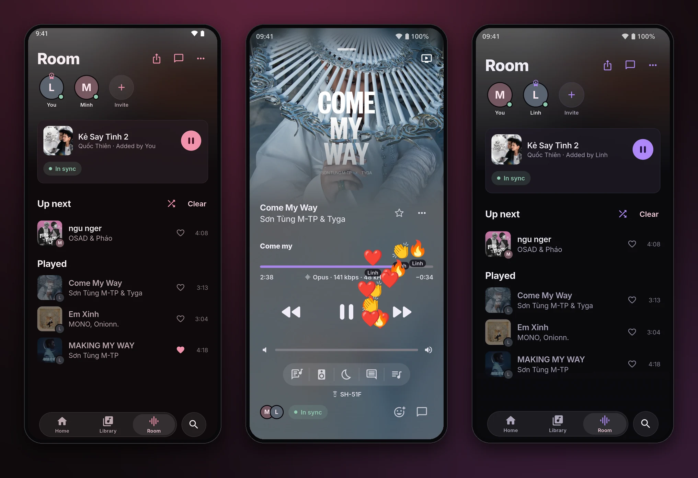
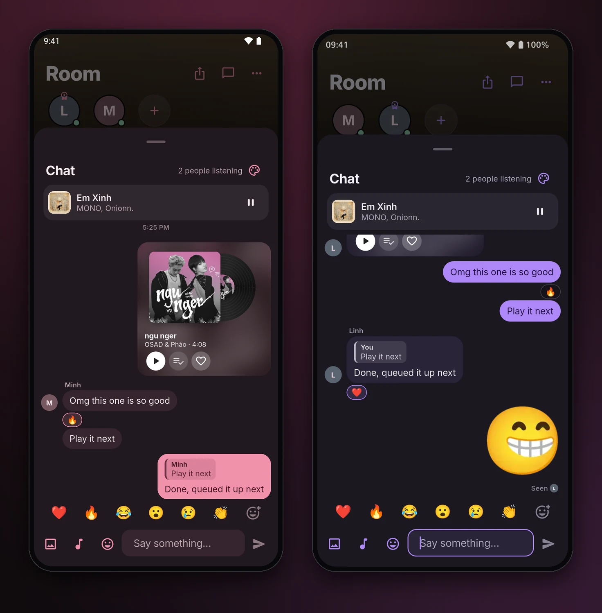
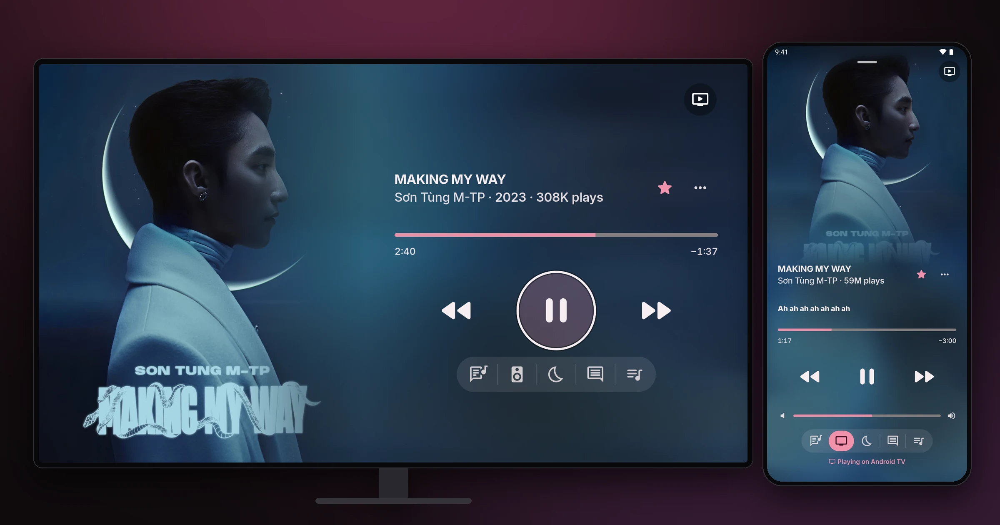
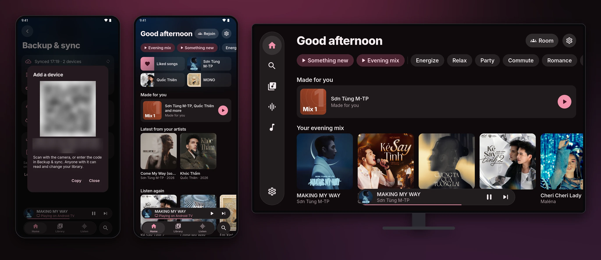

  

<h1 align="center">Sapoche</h1>

  <strong>Listen to YouTube music together, in sync, wherever you are.</strong> 
  A free music app for a small group of friends. Android, iPhone, tablet, Android TV and web.

  
  
  
  
  

  

> **A vibe-coded project.** Almost all of the code, tests and documentation were written by an AI coding assistant (Claude Code), directed by a person who tries it on real phones and decides what stays. It is a personal hobby project: expect rough edges and read the code before you trust it.

## Rooms: listen together

Start a room, share a code, a QR code or a link. Everyone hears the same song at the same moment, wherever they are, and anyone can add songs and steer playback (the owner can limit guests to adding songs). Each phone fetches its own audio, so the music keeps playing with the screen off.

## Chat and reactions

Talk while you listen: replies, reactions on messages, songs you can play or queue straight from the chat, pictures, short videos and stickers. Tap a reaction and it flies across everyone's player. A room can seal its chat with end-to-end encryption.

  

## Connect: play on another device

Your phone becomes the remote. Send the music to the TV, a browser or another phone of yours and it carries on from the same second; play, skip and volume (even the phone's volume buttons) steer the device that plays.

  

## Android TV

A layout made for the couch: big cover and buttons, and every screen works with the remote's arrow keys.

## Sync without an account

No email, no password. Turn on sync and you get one code; scan its QR code on another device and your liked songs, playlists and history are the same on all of them. The library is encrypted on the device: the server only keeps a sealed copy it cannot read.

  

Screenshots: Android phone and TV emulators and a Sharp phone. The names in the room are made up, and the sync code is hidden. Songs and cover art belong to their owners.

## And the usual

Search YouTube and YouTube Music, queue, playlists, downloads, music files already on the phone, synced lyrics, sleep timer, a home page learned on the phone from what you play, ListenBrainz and Last.fm, a home screen widget and Android Auto. Light and dark themes, your own accent colour, English and Vietnamese.

## How it works

Every device gets the stream from YouTube by itself. A free server (Cloudflare Workers and Durable Objects) only keeps the rooms, the queue, the sync clock and sealed libraries; it never holds any music, which is why it costs nothing to run.

| Folder | What is in it |
|---|---|
| [app/](app/README.md) | The Flutter app (UI) and the Kotlin playback service (Media3) |
| [app/packages/sapoche_native/](app/packages/sapoche_native/) | The iOS native side in Swift (AVFoundation) |
| [native/](native/) | Plain Kotlin libraries: stream extraction and room sync |
| [server/](server/README.md) | The room server |
| [docs/PROTOCOL.md](docs/PROTOCOL.md) | The sync protocol between the app and the server |

## Run it yourself

You need Flutter, JDK 17, the Android SDK and a free Cloudflare account. The room key and the signing key are yours and are never committed. Setup: [server/README.md](server/README.md) and [app/README.md](app/README.md).

### iPhone

Apple does not allow free, lasting installs outside the App Store, so the iOS build is for personal use:

1. GitHub Actions builds an unsigned IPA ([ios.yml](.github/workflows/ios.yml)). Download it and sign it with your own Apple ID through [SideStore](https://sidestore.io).
2. The server address and room key are not in the app. On a working Android phone open Settings > Connect another phone, then scan the QR code with the iPhone's Camera. Typing them in Settings > Advanced > Server works too.

There are no over-the-air updates on iPhone (SideStore handles that).

## Notes

- Called Unison until 1.8.6. From 1.9.0 the name and package id (`app.sapoche`) changed, so it installs next to the old app. To move a library, save a backup in the old app and add it in the new one (Settings > Backup & sync).
- This is a personal project with no commercial purpose. Getting streams from YouTube with a third-party client is not covered by YouTube's terms of service: decide for yourself before using it, and do not use it to store or redistribute music.
