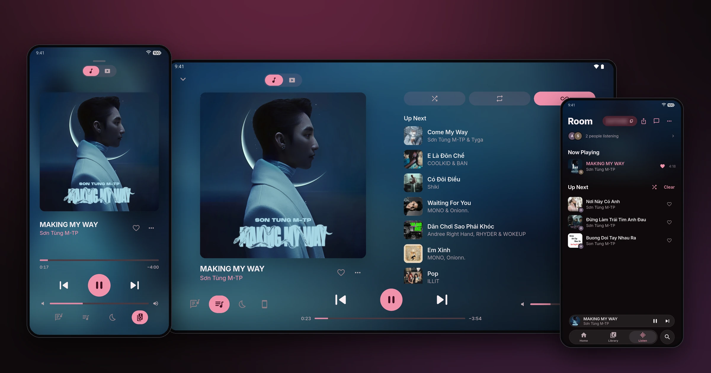
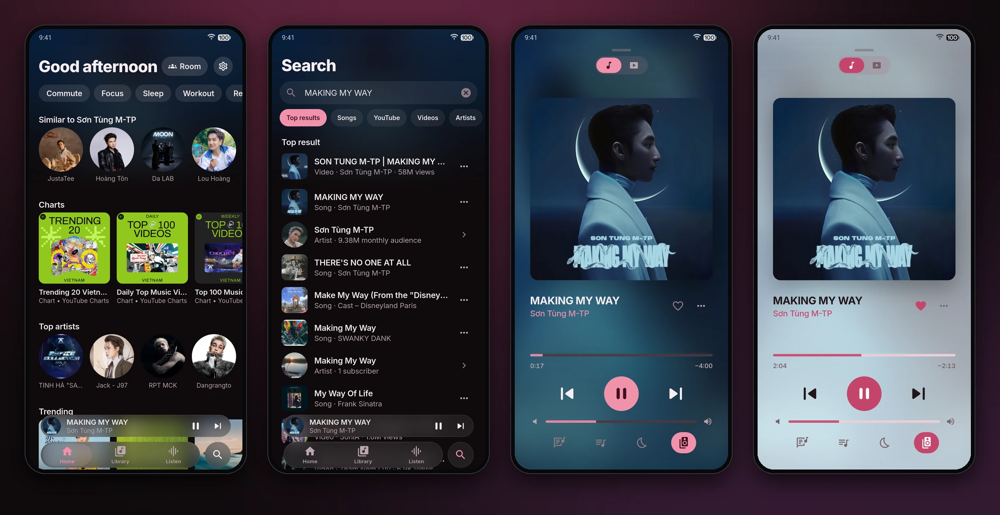
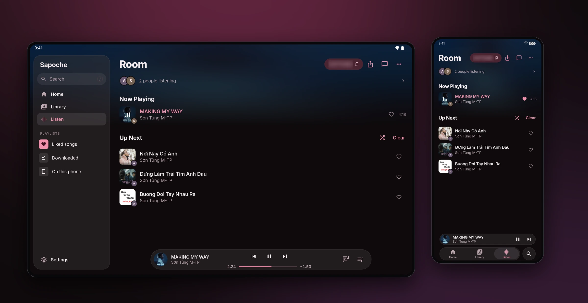
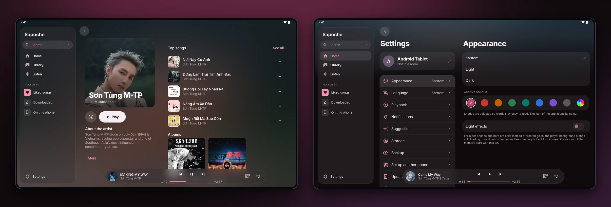

  

<h1 align="center">Sapoche</h1>

  <strong>Listen to YouTube music together, in sync, wherever you are.</strong> 
  A free music app for a small group of friends. Android, iPhone, tablet and web.

  
  
  
  

  

> **A vibe-coded project.** Almost all of the code, tests and documentation were written by an AI coding assistant (Claude Code), directed by a person who tries it on real phones and decides what stays. It is a personal hobby project: expect rough edges and read the code before you trust it.

## Features

- **Rooms.** Join with a code, a QR code or a link. Everyone hears the same song at the same moment, and anyone can add songs and steer playback (the owner can limit guests to adding songs).
- **Background playback.** Each phone fetches its own audio stream, so music keeps playing with the screen off.
- **Suggestions.** A home page learned on the phone only from what you play, like and skip.
- **Everything else.** Search YouTube and YouTube Music, queue, playlists, downloads, music files already on the phone, synced lyrics, sleep timer, sound quality choice, room chat with optional end-to-end encryption.
- **Your look.** Light and dark themes, an accent colour of your own, and a layout for phones and tablets. English and Vietnamese.

  

  

  

Screenshots: a Sharp phone and an Android tablet emulator, playing <em>MAKING MY WAY</em> by Sơn Tùng M-TP. The song and its cover art belong to their owners.

## How it works

Every phone gets the stream from YouTube by itself. A free server (Cloudflare Workers and a Durable Object) only keeps the rooms, the queue and the sync clock; it never holds any music, which is why it costs nothing to run.

| Folder | What is in it |
|---|---|
| [app/](app/README.md) | The Flutter app (UI) and the Kotlin playback service (Media3) |
| [app/packages/sapoche_native/](app/packages/sapoche_native/) | The iOS native side in Swift (AVFoundation) |
| [native/](native/) | Plain Kotlin libraries: stream extraction and room sync |
| [server/](server/README.md) | The room server |
| [docs/PROTOCOL.md](docs/PROTOCOL.md) | The sync protocol between the app and the server |

## Run it yourself

You need Flutter, JDK 17, the Android SDK and a free Cloudflare account. The room key and the signing key are yours and are never committed. Setup: [server/README.md](server/README.md) and [app/README.md](app/README.md).

### iPhone

Apple does not allow free, lasting installs outside the App Store, so the iOS build is for personal use:

1. GitHub Actions builds an unsigned IPA ([ios.yml](.github/workflows/ios.yml)). Download it and sign it with your own Apple ID through [SideStore](https://sidestore.io).
2. The server address and room key are not in the app. On a working Android phone open Settings > Set up another phone, then scan the QR code with the iPhone's Camera. Typing them in Settings > Server works too.

There are no over-the-air updates on iPhone (SideStore handles that).

## Notes

- Called Unison until 1.8.6. From 1.9.0 the name and package id (`app.sapoche`) changed, so it installs next to the old app. To move a library, save a backup in the old app and add it in the new one (Settings > Backup).
- This is a personal project with no commercial purpose. Getting streams from YouTube with a third-party client is not covered by YouTube's terms of service: decide for yourself before using it, and do not use it to store or redistribute music.
